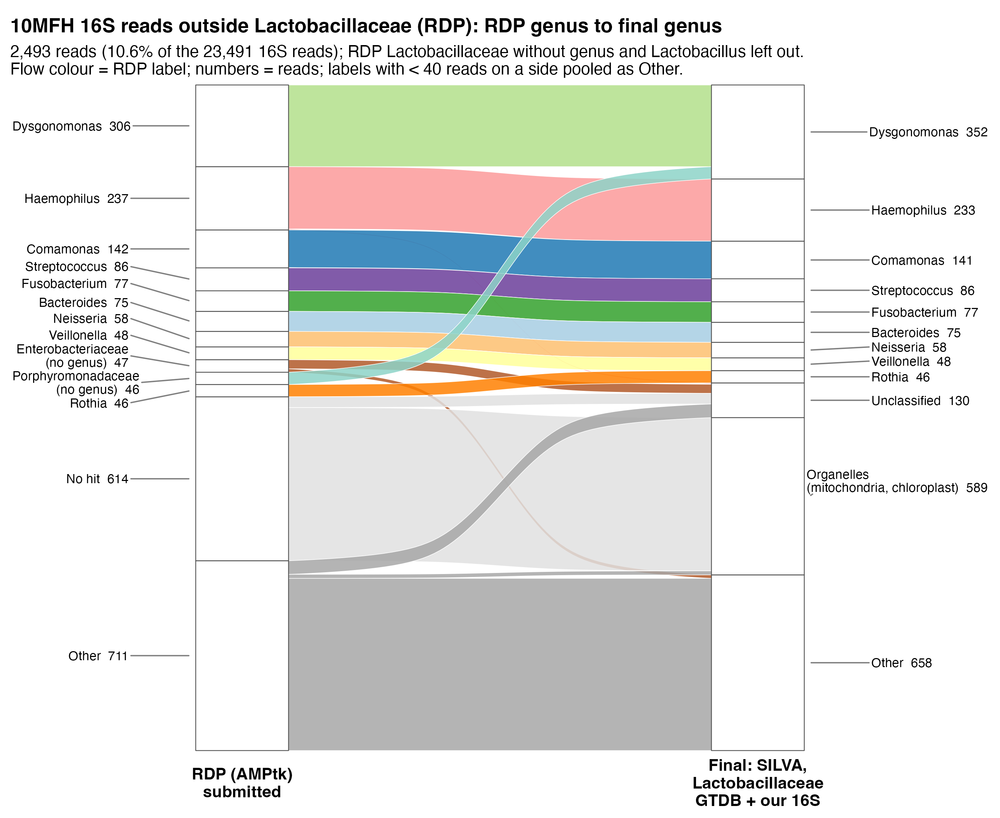
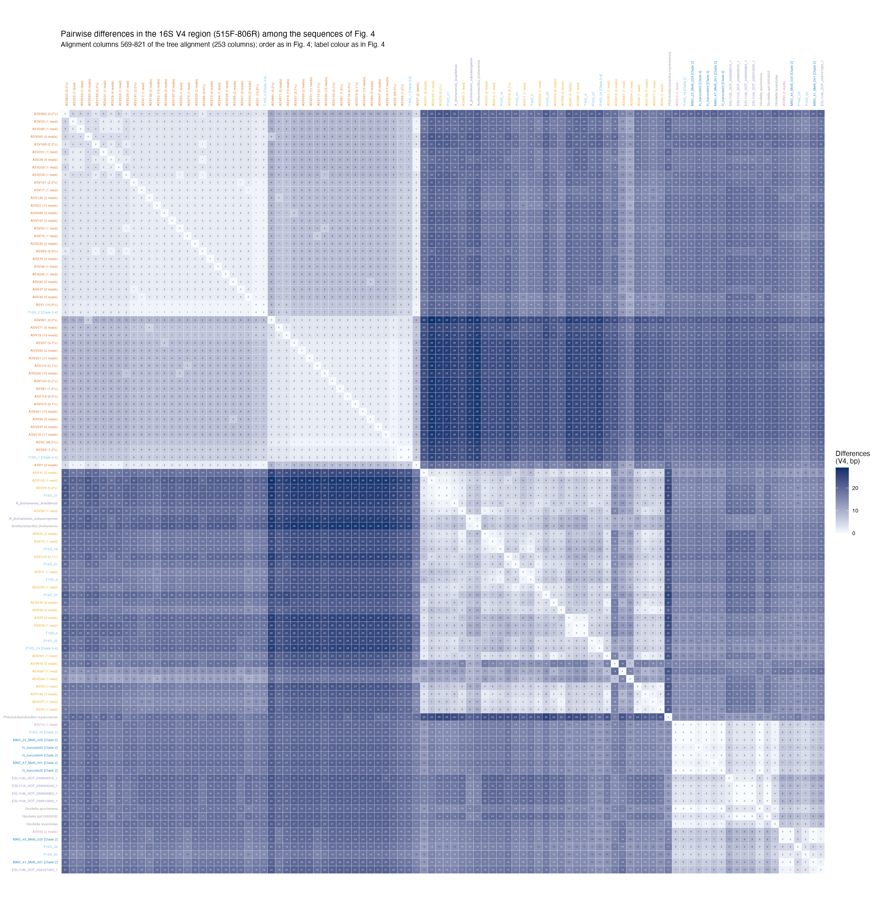

# Exploratory figures: where the RDP reads go, and how different the V4 sequences are

Two figures that support the 16S results of Chapter 6 (*Melipona favosa* honey 10MFH, sample B-VEN-D9)
without being chapter figures. The PNGs here are copies; the scripts regenerate them under `results/`.

## 1. RDP genus → final genus (alluvial)

**Script:** `exploration/scripts/19_rdp_gtdb_alluvial.R` (input `results/11_compare/genus_by_asv.tsv` from
`11_compare.py`) → `results/19_rdp_gtdb_alluvial/` (`rdp_final_alluvial.png/pdf`, flows in `rdp_to_final.tsv`).

**What it shows.** The 2,493 reads (10.6% of the 23,491 16S reads) that RDP (AMPtk, the submitted chapter)
did *not* call Lactobacillaceae without genus or *Lactobacillus*. Left: the RDP label (genus, else
"family (no genus)", else No hit). Right: the final classification of Table 6.5: organelle 16S set apart with
SILVA 138.2, Lactobacillaceae named with GTDB r226 + our stingless bee 16S, every other ASV with SILVA 138.2.
Each flow is the reads of the ASVs sharing that pair of labels; flows are coloured by the RDP label; labels with
fewer than 40 reads on a side are pooled as Other. (The Lactobacillaceae reads are left out because they are
the subject of Fig. 6.4B and C: 20,870 of them go to *Acetilactobacillus* Clade 3-4.)

**Reading it.**
- RDP "No hit" (614 reads) is mostly organelle 16S (574 reads), plus 40 reads still unclassified.
- *Dysgonomonas*, *Haemophilus*, *Comamonas*, *Streptococcus*, *Fusobacterium*, *Bacteroides*, *Neisseria*,
  *Veillonella* and *Rothia* keep their genus; Porphyromonadaceae without genus (46) become *Dysgonomonas*.

**Why the final classification is not GTDB alone.** With GTDB r226 (with or without our 16S) as the only
reference, the same reads went to *Microbacterium* (473), RAAP-2 (49), *Escherichia* (222 from RDP
*Haemophilus*) and *Rothia* (62 from RDP *Fusobacterium*). Checked by hand with BLAST (`blastn` 2.16.0+, NCBI
RefSeq 16S and mitochondrial genomes, October 2026; not part of the scripts):

| ASV (reads) | RDP | SILVA 138.2 | GTDB r226 | Best BLAST hit |
|---|---|---|---|---|
| ASV180 + ASV285 (473) | No hit | Mitochondria | *Microbacterium* (0.84–0.98) | 93% to the *Aspergillus niger* mitochondrion over the whole ASV; no hit to *Microbacterium*; 35–37% GC |
| ASV59 (222) | *Haemophilus* | *Haemophilus* | *Escherichia* (1.00) | 100% *H. parainfluenzae*; 87% *E. coli* |
| ASV112 (62) | *Fusobacterium* | *Fusobacterium* | *Rothia* (0.91) | 98.4% *Fusobacterium*; < 80% *Rothia* |
| ASV165 (16) | *Veillonella* | *Veillonella* | *Escherichia* (0.98) | 98.4% *V. parvula* |

GTDB has no mitochondrial or chloroplast 16S, so SINTAX puts organelle reads on the closest bacterium; the
SINTAX confidence only measures agreement inside the reference, not identity. The *Escherichia* and *Rothia*
calls are probably 16S copies from contaminated genome assemblies carrying the genome's taxonomy (not verified).
Hence the order: organelles out first (SILVA), Lactobacillaceae with GTDB + our 16S (validated by placement and
by ≥ 99% identity to the stingless bee 16S), the rest with SILVA. No Lactobacillaceae ASV has any SILVA vote for
mitochondria or chloroplast (asserted in `11_compare.py`).

## 2. Pairwise V4 differences (heatmap)

**Script:** `exploration/scripts/12_figures.R` (Figure 5; input the tree alignment of `results/08_tree/`) →
`results/12_figures/fig5_V4_differences_heatmap.png/pdf`, matrix in `fig5_V4_differences.tsv`.
(The clean pipeline makes the same matrix in `pipeline/09_summarise.py`.)

**What it shows.** Number of differing positions in the V4 region (515F–806R, alignment columns 569–821, 253
columns) between every pair of sequences of the *Nicoliella*–*Acetilactobacillus* tree (Fig. 6.4C): the
*M. favosa* Lactobacillaceae ASVs (orange, with their reads), our recovered 16S (T16S, P16S), the 16S of the
Xolalpa-Aroche et al. (2026) MAGs and isolates, and GTDB representatives. Rows and columns follow the tree order;
label colours as in the tree. Light = identical, dark = up to ~28 differences.

**Reading it.**
- Top-left: the Clade 3-4 ASVs form two V4 variants, represented by T16S_2 (ASV1, 0 differences) and T16S_1
  (ASV2, 1 difference); the two variants differ in 5–6 positions.
- Both variants are 21–27 positions away from *Acetilactobacillus jinshanensis* and the other public
  *Acetilactobacillus* (middle block), which is why RDP, SILVA and GTDB could not give them a genus.
- Bottom-right: the *Nicoliella* / Clade 2 block (MAGs, isolates and ASV83, ASV10), clearly apart from
  Clade 3-4.

Expected values (also in `docs/METHODS.md`, section 8): ASV1–ASV2 6, ASV1–T16S_2 0, ASV2–T16S_1 1,
T16S_1–T16S_2 5.
